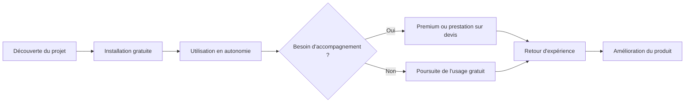

# Business Model Canvas de Rustkins

> **Objet :** synthèse utilisable dans le dossier entrepreneurial. La source de vérité détaillée demeure le [modèle économique de Rustkins](business-model.md). Ce canvas ne crée pas de nouvelle politique commerciale.

## 1. Hypothèse centrale

Rustkins propose **un moteur CI/CD open source, gratuit et auto-hébergé**, sans offre SaaS exploitée par l'éditeur. La monétisation envisagée porte sur **un accompagnement facultatif** : abonnement premium, prestation de déploiement chez le client et développement spécifique facturable.

Le [business plan 2027–2030](business-plan.md) chiffre les trois sources de revenus et les coûts associés. La disposition à payer, les volumes et la capacité à livrer restent à vérifier auprès des équipes pilotes.

## 2. Les neuf blocs du Business Model Canvas

| Bloc | Contenu Rustkins | Niveau de validation |
| --- | --- | --- |
| **1. Segments de clientèle** | Priorité commerciale aux PME et petites équipes techniques françaises qui auto-hébergent leur CI/CD. Les indépendants et projets personnels peuvent adopter le moteur gratuit. | **Hypothèses de cible**, à confirmer par entretiens et pilotes. |
| **2. Proposition de valeur** | Moteur CI/CD gratuit, librement installable sur l'infrastructure utilisateur ; configuration YAML et exécution Docker ; suivi des exécutions ; services facultatifs pour réduire l'effort d'adoption ou répondre à des besoins particuliers. | **Orientation produit documentée** ; valeur perçue et différenciation à tester. |
| **3. Canaux** | GitHub, documentation publique, démonstrations, pilotes, communauté et prospection B2B. | **Canaux et budget modélisés** dans le prévisionnel. |
| **4. Relations clients** | Communauté et documentation pour l'offre gratuite ; échanges plus fréquents et priorisation de certains bugs pour les abonnés premium ; suivi contractuel par devis pour installations et développements spécifiques. | **Modèle relationnel envisagé** ; outils, SLA et conditions à définir. |
| **5. Sources de revenus** | Trois packs de support facultatifs, déploiements sur infrastructure cliente et développements spécifiques sur devis. | **Tarifs et chiffre d'affaires prévisionnels**, à tester auprès des pilotes. |
| **6. Ressources clés** | Compétences des trois fondateurs, code source, documentation, outillage et renforts prévus en commercial puis en support et intégration. | **Capacité prévisionnelle**, à vérifier avec la charge réelle. |
| **7. Activités clés** | Concevoir, développer, tester et publier Rustkins ; traiter les anomalies ; maintenir les instructions de déploiement ; assurer les prestations convenues ; animer la relation avec les utilisateurs. | **Activités cohérentes avec le modèle**, charge opérationnelle à mesurer. |
| **8. Partenaires clés** | Communauté open source, premiers utilisateurs pilotes, prestataires juridiques/comptables et intégrateurs potentiels ; écosystèmes Git/Docker et infrastructures clientes. | **Hypothèses de collaboration**, pas de partenariat contractuel affirmé. |
| **9. Structure de coûts** | Rémunérations, télétravail, site vitrine et CI interne, acquisition, déplacements, comptabilité et prestations juridiques, RGPD et sécurité. | **Coûts chiffrés** dans le prévisionnel. |

## 3. Traduction concrète des offres

### Logiciel de base : gratuit et auto-hébergé

Le client installe et exploite son instance. Il prend en charge ses serveurs, la sécurité opérationnelle, les sauvegardes et les mises à jour, sous réserve d'un contrat de services distinct. La licence open source exacte reste à choisir. L'ambition est de ne **pas** rendre l'abonnement indispensable au fonctionnement de la plateforme.

### Abonnement premium : accompagnement, pas hébergement

L'abonnement vise des échanges plus réguliers, une meilleure prise en compte des besoins et une priorité relative dans le traitement des bugs. Il **n'inclut pas par défaut** l'administration de l'instance cliente, une prise en main à distance, une garantie de délai de résolution ou le développement illimité de fonctions spécifiques.

### Prestation d'installation et de déploiement

Rustkins pourrait réaliser, contre rémunération, l'installation et la configuration initiale sur l'infrastructure du client. Ce service est indépendant de l'abonnement premium et ne constitue **pas** une prestation SaaS.

### Développement spécifique sur devis

Une fonctionnalité majeure, comme une intégration à un outil tiers, pourrait être estimée et facturée séparément. La commande doit préciser les livrables, les modalités de paiement et la maintenance éventuelle. **Le financement n'implique pas automatiquement une exclusivité sur le code.**

## 4. Parcours d'adoption et création de valeur (hypothèse)

Ce parcours illustre le **modèle recherché**. Il devra être testé pour vérifier si les utilisateurs parviennent à installer l'outil, s'ils perçoivent une valeur suffisante et quelles prestations ils seraient réellement prêts à acheter.

## 5. Logique économique et risques

### Sources de revenus et coûts

Le prévisionnel distingue :

- **Revenus récurrents :** abonnements premium effectivement facturés et conservés.
- **Revenus ponctuels :** installations et développements spécifiques, facturés selon les contrats.
- **Coûts fixes :** administration, outillage, services nécessaires au projet et disponibilité minimale de l'équipe.
- **Coûts variables :** temps de support, charge de développement et dépenses propres aux prestations.

Le scénario prévoit un premier bénéfice annuel en 2029. Les pilotes permettront de mesurer le **temps moyen de support par abonnement**, la **marge des prestations après temps passé** et la **capacité de l'équipe**.

### Risques principaux

| Risque | Conséquence / expérimentation nécessaire |
| --- | --- |
| Faible conversion du gratuit vers le payant | Vérifier les besoins réels de support et la disposition à payer |
| Support prioritaire très consommateur de temps | Définir périmètre, règles de priorité et limites contractuelles |
| Maintenance d'intégrations spécifiques trop coûteuse | Chiffrer maintenance et compatibilité dès le devis |
| Confusion entre auto-hébergement et service infogéré | Clarifier la responsabilité d'exploitation du client |
| Accès anticipé à certaines fonctions et exigence open source | Vérifier la cohérence avec la licence et les règles de redistribution avant toute offre |
| Promesses commerciales avant maturité du produit | Ne communiquer que des capacités démontrées, avec leur version |

**Point particulier :** une période d'accès privilégié à certaines nouveautés, évoquée à titre indicatif autour de trois mois, **n'est pas arrêtée**. Elle soulève une question à résoudre avec la licence open source et ne doit figurer dans aucune offre comme une garantie acquise.

## 6. Validations prioritaires avant lancement commercial

1. **Problème client :** mener des entretiens avec des équipes qui administrent leur propre CI/CD, documenter leurs contraintes et leurs alternatives actuelles.
2. **Adoption :** faire installer une V0/V1 par des utilisateurs extérieurs, mesurer les difficultés et la récurrence d'usage.
3. **Disposition à payer :** tester séparément l'intérêt pour le support premium, l'installation et le développement spécifique.
4. **Coût de service :** chronométrer le traitement de demandes pilotes et estimer la capacité de l'équipe.
5. **Politique open source :** définir licence, contributions et éventuelles modalités d'accès anticipé.
6. **Tarification :** tester les trois packs et ajuster le prévisionnel selon la conversion, le renouvellement et la charge observés.

## 7. Références internes

- [Modèle économique détaillé et arbitrages ouverts](business-model.md)
- [Présentation du produit](../company/project-presentation.md)
- [Organisation de l'équipe et structure envisagée](../company/company-structure.md)
- [Roadmap du produit](../../versions/roadmap.md)
