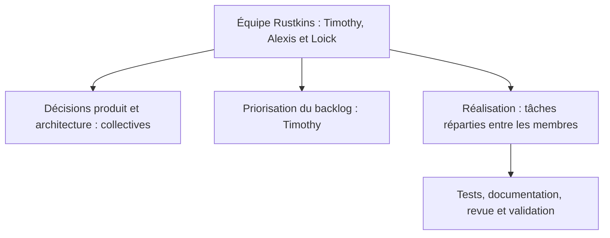

# Structure de l'équipe et de l'entreprise Rustkins

> **Distinction essentielle :** ce document présente d'abord **l'organisation actuelle du projet** puis **l'organisation d'une entreprise éventuelle**. Aucun statut juridique, immatriculation, répartition de capital, titre de dirigeant ou contrat commercial n'est établi par les sources consultées.

## 1. Situation actuelle : une équipe projet

Rustkins est porté par **trois membres : Timothy, Alexis et Loick**. Ils conçoivent et organisent ensemble le développement du produit. La gouvernance de projet officielle prévoit des décisions collectives sur la vision, les évolutions structurantes et la validation des versions.

Les responsabilités formalisées dans la documentation concernent essentiellement le **pilotage du produit** et l'organisation du travail :

| Responsabilité de projet documentée | Fonctionnement |
| --- | --- |
| Vision, choix structurants et validation des versions | Décisions prises collectivement par Timothy, Alexis et Loick |
| Priorisation du Product Backlog | Pilotage par Timothy, après échanges avec l'équipe |
| Définition des objectifs de sprint | Décision collective |
| Coordination des modifications du Sprint Backlog | Timothy |
| Développement, tests et documentation | Réalisation par le membre responsable de chaque tâche, avec validation selon la Definition of Done |
| Validation finale des User Stories | Décision humaine en Sprint Review |

Cette répartition **ne préjuge pas des fonctions de président, gérant, associé, salarié ou responsable commercial** d'une future entreprise.

## 2. Organisation opérationnelle

L'équipe fonctionne de manière collaborative et principalement asynchrone, avec Azure Boards pour le backlog, GitHub pour le code et les PR, et RustkinsDocs pour la documentation et les décisions formalisées. RustkinsActivity documente les interventions ; des outils internes facilitent le partage de connaissances.

Les évolutions importantes sont décrites par des documents versionnés, revues et, pour les arbitrages d'architecture, par des ADR. Les tâches et leurs états restent suivis dans Azure Boards ; le dépôt documentaire ne remplace pas la gestion opérationnelle.

## 3. Structure cible d'une activité économique

Si Rustkins devient une entreprise, son activité envisagée serait celle d'un **éditeur de logiciel open source proposant des services B2B complémentaires**. Il convient de distinguer :

- **Produit :** développement, publication, maintenance et sécurité de la plateforme auto-hébergée.
- **Services :** support prioritaire optionnel, installation/configuration sur infrastructure cliente, évolutions spécifiques après devis.
- **Relation client :** qualification du besoin, contractualisation, facturation et traitement des demandes.
- **Fonctions support :** comptabilité, administration, conformité, assurance, propriété intellectuelle et protection des données.

L'entreprise **n'aurait pas vocation, selon le modèle actuel, à héberger les instances CI/CD de ses clients en SaaS**. Elle pourrait cependant exploiter sa propre infrastructure interne pour développer, tester, documenter et présenter Rustkins.

## 4. Répartition fonctionnelle proposée pour une petite structure

La structure suivante est **une proposition d'organisation**, à discuter entre les trois membres avant toute formalisation. Elle décrit des fonctions à couvrir, pas des postes déjà attribués ni trois départements salariés.

| Fonction | Missions envisagées | Mode d'organisation possible |
| --- | --- | --- |
| Direction produit | Vision, roadmap, priorités, retours utilisateurs | Coordination produit avec arbitrage collectif |
| Ingénierie et qualité | Architecture, développement, tests, sécurité, releases | Répartition des tâches selon expertises et disponibilités |
| Exploitation et intégration | Paquets de déploiement, documentation d'installation, interventions clientes | Référent technique désigné pour chaque prestation |
| Commercial et relation client | Prospection, découverte des besoins, offres, support premium | Responsabilité identifiée par dossier client |
| Gestion et conformité | Contrats, facturation, finances, propriété intellectuelle, RGPD | Responsable désigné puis recours à des conseils spécialisés si nécessaire |

Le cumul de plusieurs fonctions par une même personne serait normal au lancement. L'objectif est d'éviter les angles morts : une prestation facturée doit avoir un responsable, un périmètre accepté et des conditions de maintenance explicites.

### Équipe budgétée de 2027 à 2030

Le [business plan](../business-model/business-plan.md) suppose trois fondateurs actifs à temps plein dès janvier 2027, en télétravail intégral. Les montants ci-dessous correspondent au brut annuel équivalent temps plein au démarrage de chaque rémunération.

| Rôle | Début de la rémunération | Brut annuel | Répartition ou missions |
| --- | --- | ---: | --- |
| Timothy | Janvier 2027 | 36 000 € | 40 % développement et 60 % direction produit, pilotage, vente et communication |
| Alexis | Juillet 2028 | 36 000 € | 80 % développement et 20 % tâches transverses, dont coordination et suivi client |
| Loick | Juillet 2028 | 36 000 € | 80 % développement et 20 % tâches transverses, dont coordination et suivi client |
| Commercial et communication | Juillet 2029 | 40 000 € | Prospection, démonstrations, suivi des devis et animation des canaux |
| Support technique et intégration | Juillet 2030 | 44 000 € | Traitement des demandes, déploiements et accompagnement technique |

Alexis et Loick sont budgétés sans rémunération pendant les dix-huit premiers mois. Leurs droits éventuels à l'ARE sont à confirmer individuellement. Le prévisionnel majore le brut de 42 % pour estimer le coût employeur. La comptabilité et la paie sont externalisées, avec des interventions spécialisées pour les contrats, le RGPD et la sécurité.

## 5. Forme juridique et gouvernance capitalistique : non décidées

À ce stade, les sources du projet **ne précisent pas** :

- si une société est déjà immatriculée ;
- le pays d'établissement juridique retenu ;
- la forme sociale, les mandataires sociaux ou les statuts ;
- la répartition des parts ou actions, les apports et la propriété des actifs ;
- les contrats entre fondateurs, contributeurs et éventuels clients.

Le dossier entrepreneurial retient une **SAS en France** comme hypothèse de chiffrage. Le choix de la forme sociale et le statut des fondateurs restent à valider après examen juridique, fiscal et social.

Les sujets à arbitrer incluent les pouvoirs de décision, les entrées/sorties d'associés, le financement, la rémunération, la gestion d'un désaccord et le sort du code développé avant la création de l'entité.

## 6. Ressources et partenaires clés

**Ressources existantes dans la documentation :** travail des trois membres, dépôts GitHub, documentation technique et processus Agile. Les outils internes (RustkinsMCP, RustkinsActivity, RustkinsSkills et DiscordBot) soutiennent le travail de l'équipe, mais **ne constituent pas le produit CI/CD vendu aux clients**.

**Ressources à prévoir pour une activité commerciale :** capacité de support, documentation d'installation, démonstrations, environnements de test, gestion des contacts et des devis, suivi du temps d'intervention, outils de facturation et accompagnement juridique/comptable selon les besoins.

Les éventuels partenaires d'hébergement, distributeurs, revendeurs ou intégrateurs restent **des pistes de développement**, pas des accords établis.

## 7. Principaux processus d'une entreprise future

1. **Conception :** collecte des retours, qualification du besoin, arbitrage de la roadmap.
2. **Production :** développement, tests, revues, publication de versions et documentation.
3. **Distribution :** mise à disposition du logiciel et des instructions d'auto-hébergement.
4. **Vente de services :** expression du besoin, devis et périmètre contractualisé.
5. **Exécution :** installation chez le client ou réalisation de l'évolution convenue, avec critères de réception.
6. **Support :** suivi des demandes selon l'offre effectivement souscrite, sans promettre de SLA non définis.
7. **Amélioration :** analyse du retour d'expérience et ajustement de l'offre.

## 8. Points à valider avant de finaliser ce volet

| Sujet | Question de décision |
| --- | --- |
| Existence juridique | Présente-t-on Rustkins comme un projet en pré-création ou comme une société effectivement constituée ? |
| Implantation et statut | Où et sous quelle forme l'activité serait-elle portée ? |
| Gouvernance de l'entreprise | Qui représente légalement la structure ? Comment sont décidés les engagements commerciaux ? |
| Capital et propriété intellectuelle | Quels apports, quelle répartition et quels droits sur le code et la marque ? |
| Ressources humaines | Quelles disponibilités réelles pour le développement et le support payant ? |
| Cadre contractuel | Quelles conditions de support, d'installation, de responsabilité et de maintenance ? |
| Charges prévisionnelles | Quels coûts fixes, variables et objectifs de trésorerie, une fois les hypothèses vérifiées ? |

Ces questions sont à traiter **avant toute affirmation sur l'existence, la composition juridique ou la solidité financière d'une entreprise Rustkins**.

## 9. Références internes

- [Principes et gouvernance du projet](../../project-management/principles-and-governance.md)
- [Documentation et sources de vérité](../../conventions/knowledge-management.md)
- [Présentation du projet](project-presentation.md)
- [Modèle économique de référence](../business-model/business-model.md)
- [Compte rendu du point RGPD du 9 novembre 2026](../gdpr/meeting-notes/2026-11-09-rgpd-meeting.md)
