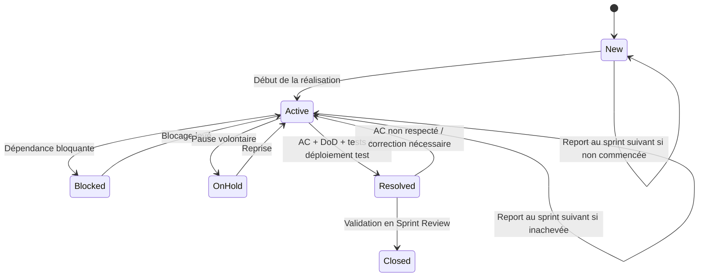

# États Azure Boards et gestion des dépendances

## 1. Colonnes Azure Boards, états et dépendances

### 1.1. États Azure DevOps et colonnes du Board

Dans Rustkins, **un statut est un état réel du work item**, enregistré dans le champ Azure DevOps `System.State` et **représenté aussi par une colonne du Board**. Les états `Blocked` et `On Hold` seront ajoutés aux types **User Story** et **Task** dans un **processus Agile hérité**. Ils sont tous deux associés à la catégorie système **In Progress**, ce qui signifie que l'élément reste en cours et n'est pas considéré comme livré.

| Type | États prévus (et colonnes correspondantes) | Catégories des états à distinguer |
|---|---|---|
| US | `New` → `Active` / `Blocked` / `On Hold` → `Resolved` → `Closed` | `Blocked`, `On Hold` : **In Progress** ; `Resolved` Agile hérité : **In Progress** |
| Task | `New` → `Active` / `Blocked` / `On Hold` → `Closed` | `Blocked`, `On Hold` : **In Progress** |
| Bug | `New` → `Active` → `Resolved` → `Closed` | Conserver le workflow du Bug, sous réserve de sa configuration réelle |
| Issue | États du processus Agile configuré | Pas de personnalisation définie pour le moment |
| Epic / Feature | `New` → `Active` → `Closed` | Pas de personnalisation définie pour le moment |

`Blocked` et `On Hold` ne sont **pas deux étapes successives** : ils constituent des états alternatifs à `Active`. Le passage à `Resolved` requiert la DoD complète ; le passage de l'US à `Closed` intervient uniquement pendant la Sprint Review.

**Configuration requise :** créer `Blocked` et `On Hold` sur chacun des types US et Task, choisir la catégorie **In Progress**, puis configurer les colonnes du Board correspondant à ces états. Confirmer que l'état Agile hérité `Resolved` est disponible pour les US. Sa catégorie système est **In Progress** et ne peut pas être modifiée dans un processus hérité ; les requêtes, les indicateurs et les skills doivent donc distinguer `Resolved` par `System.State` et ne compter comme livrées que les US `Closed`. Ne pas confondre la **catégorie système** avec le **nom de l'état** (`Active`, `Blocked`, `On Hold`, `Resolved`, `Closed`).

**Particularité Azure DevOps :** le Board des US et le **Taskboard du sprint** ne partagent pas exactement la même configuration d'affichage. L'ajout d'états personnalisés aux Tasks peut créer des colonnes sur le Taskboard ; il faut vérifier leur ordre et leur correspondance. Les skills doivent d'abord lire et modifier **`System.State`**, puis contrôler la colonne réellement affichée et corriger sa configuration si nécessaire. Une modification de `System.BoardColumn` seule ne suffit pas à matérialiser un changement d'état.

### 1.2. Signification des états et colonnes

| État / colonne | Signification et sortie |
|---|---|
| `New` | Travail non commencé. Peut être prêt ou non pour un sprint ; une dépendance anticipée y est référencée sans prétendre que le travail a commencé |
| `Active` | Réalisation, tests et intégration en cours ; reprise après une pause ou un blocage |
| `Blocked` | Travail commencé qui **ne peut pas avancer à cause d'une dépendance identifiée** ; lien Azure et motif obligatoires quand un work item bloquant existe |
| `On Hold` | Travail commencé temporairement **mis en pause sans dépendance bloquante**, par exemple en raison d'un changement de disponibilité ou de priorité ; raison et condition de reprise consignées |
| `Resolved` | **US :** tous les AC et la DoD sont satisfaits, tests réussis, Tasks fermées, déploiement en test prouvé ; en attente de la Sprint Review |
| `Closed` | **US :** acceptée en Sprint Review ; **Task :** sa DoD est satisfaite ; état final non utilisé pour une annulation |

Pour une US non commencée, conserver l'état `New` même si une dépendance future est connue ; le lien de dépendance peut être renseigné dès cette étape. Les états `Blocked` et `On Hold` sont réservés à un travail effectivement commencé, puis interrompu.

### 1.3. Cycle de vie d'une US

Ce diagramme représente **à la fois les transitions entre les états réels `System.State` et le déplacement de leurs cartes dans les colonnes correspondantes**. `Active`, `Blocked`, `On Hold` et l'état Agile hérité `Resolved` sont quatre états distincts de la catégorie système **In Progress**. La règle métier continue de réserver `Resolved` aux US prêtes pour la review.

Une interruption de travail, un arrêt de l'agent ou la fin d'une conversation ne justifie pas à lui seul `Closed`, `Resolved` ni la suppression de l'US.

### 1.4. Dépendances

Les liens Azure **`Predecessor` / `Successor`** représentent les dépendances ordonnées ; `Related` désigne une association sans ordre, et `Parent / Child` la hiérarchie.

Lorsqu'une Task ou une US est bloquée :

1. Rechercher le work item prédécesseur avant d'en créer un nouveau et ajouter le lien directionnel adapté.
2. Indiquer le motif, l'action attendue, la personne responsable du déblocage et l'effet éventuel sur le sprint.
3. Passer l'élément dans l'état `Blocked` (et sa colonne) **uniquement si le travail a commencé et qu'aucune progression utile n'est possible**.
4. Si le blocage est externe et n'a pas de work item, le documenter explicitement sans inventer un identifiant Azure.
5. Après levée du blocage, vérifier la condition effective avant le retour à `Active`.

`On Hold` est réservé aux pauses qui ne dépendent pas de la résolution d'un autre work item : une simple indisponibilité de développeur, par exemple. Les deux **états** doivent être distingués dans les requêtes Azure et les rapports, ainsi que sur les colonnes du Board.

---

