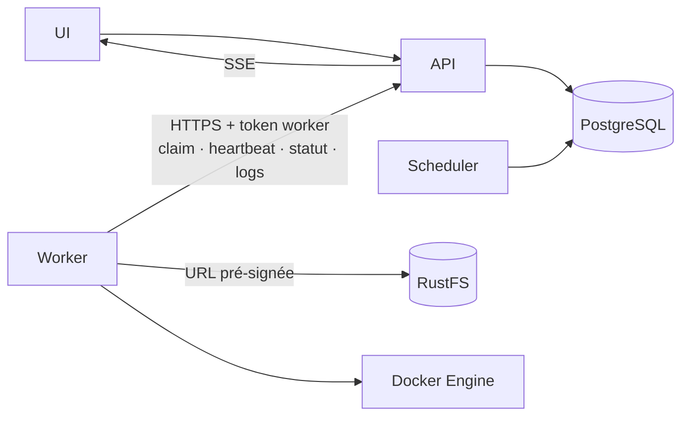

# Rustkins — Inventaire des features par coût d'implémentation

> **Légende coût :**
> **Faible** = quelques jours, peu de pièges · **Moyen** = une à deux semaines, des cas limites · **Élevé** = gros morceau, source de bugs.

---

## Contraintes d'architecture — elles conditionnent les coûts ci-dessous

1. **Les workers ne touchent jamais la base de données.** Ils n'ont ni identifiants PostgreSQL ni accès réseau à la base. Un worker exécute du code utilisateur avec accès au socket Docker : s'il est compromis, il ne doit pas pouvoir lire ou modifier l'état des autres projets.
2. **Le control plane (API + Scheduler) est le seul à lire et écrire PostgreSQL.** Les workers parlent uniquement à la **Worker API** du control plane, en HTTPS, authentifiés par un token propre à chaque worker.
3. **Pas de broker de messages (RabbitMQ retiré).** La file de jobs est une table PostgreSQL côté control plane. Les workers **tirent** leurs jobs par long-polling (même modèle que GitLab Runner ou les runners GitHub Actions). Le dispatch se fait dans la même transaction que la réservation des ressources, donc il n'y a ni outbox, ni double écriture, ni service supplémentaire à exploiter.
4. **Accès au stockage par URL pré-signée.** Le control plane donne au worker des URLs RustFS limitées à son JobRun (logs, artefacts, cache). Le worker n'a pas de clé RustFS globale.

---

## Socle incompressible — sans ça, pas de moteur

| Feature | Coût | Ce que ça ajoute concrètement |
|---|---|---|
| Parser de ton format YAML | Moyen | Validation de schéma, gestion des erreurs lisibles, résolution de la hiérarchie env. C'est ta porte d'entrée, elle doit être robuste. |
| DAG in-degree + détection de cycle | Faible | L'algo est trivial (compteur). Le coût réel = le câbler sur un état **persistant**, pas juste en mémoire. |
| Steps séquentiels par job | Faible | Boucle ordonnée, arrêt au premier step rouge, capture exit code par step. |
| 1 container Docker/job + champ `image` | Faible | bollard fait le travail. Create → start → wait → logs → remove. |
| Limites CPU/RAM container | Faible | Passées à l'API Docker au create. Presque gratuit. |
| PostgreSQL + entité job-run | Faible/Moyen | Schéma propre (définition vs instance), transitions transactionnelles. Seul le control plane y accède. |
| **Worker API** (enregistrement, token, claim, statut) | Moyen | Endpoints HTTPS dédiés aux workers : `register`, `claim` (long-poll), `heartbeat`, `status`, `logs`. Le claim renvoie **tout** ce dont le job a besoin (SHA, image, steps, env, URLs pré-signées) : le worker n'a rien à aller relire ailleurs. |
| File de jobs PostgreSQL (`SKIP LOCKED`) | Faible | Le JobRun `queued` + `worker_id` **est** le message. Le claim fait `UPDATE … WHERE id = (SELECT … FOR UPDATE SKIP LOCKED LIMIT 1)`. `LISTEN/NOTIFY` côté API réveille le long-poll en attente. Le job atterrit forcément sur le worker qui a reçu la réservation. |
| Logs persistés sur rustfs | Faible/Moyen | RustFS est compatible S3 : **pas d'append**. Il faut un objet par segment (ex. toutes les N secondes ou N Ko) ou un buffer local envoyé en fin de job. |
| Clone Git au SHA | Faible | libgit2 ou shell out. Attention aux repos privés (clés de déploiement transmises par le claim, jamais stockées sur le worker). |
| Fail-fast (job rouge → downstream `skipped`) | Faible | Tombe naturellement du DAG : tu ne décrémentes pas. |
| Statut de base dans l'UI | Moyen | Liste de runs, statut par job. Le minimum pour "voir" le système. |

---

## Coût moyen — utile, négociable

| Feature | Coût | Ce que ça ajoute concrètement |
|---|---|---|
| Logs temps réel (SSE tail) | Moyen | Worker → `POST /worker/jobs/{id}/logs` → l'API diffuse en SSE depuis un buffer mémoire. Reconnexion, multi-client, rattrapage du déjà-écrit depuis RustFS. Avec plusieurs instances d'API : fan-out via `NOTIFY` (contenu ≤ 8 Ko, donc chunks ≤ 8 Ko). Tu peux le **couper au MVP** (logs après coup) et l'ajouter ensuite. |
| Heartbeat + lease des jobs | Faible/Moyen | Le worker renouvelle son bail via la Worker API. Bail expiré → le Scheduler libère les ressources et décide retry ou `dead_lettered`. Remplace l'ACK/NACK d'un broker. |
| Scheduling resource-aware (admission CPU/RAM) | Moyen | Compteur de capacité nœud, réservation/libération. Sans ça tu sur-souscris le nœud. |
| Annulation (kill in-flight) | Moyen | Le control plane passe le JobRun en `cancel_requested`, le worker l'apprend dans la réponse au heartbeat (ou via un long-poll dédié), tue le container et confirme. Pas de broadcast à tous les workers. |
| Retry + idempotence | Moyen | Retry décidé par le Scheduler, en base. Le claim est atomique (`SKIP LOCKED`) et chaque tentative a son `attempt` : un worker qui revient après expiration de son bail voit ses écritures refusées (`409`). |
| Webhook trigger (HMAC) | Faible | Vérif signature. Petit mais obligatoire pour Git. |
| Auth UI (JWT) | Faible/Moyen | Login + middleware. |
| API tokens scopés (trigger machine) | Faible | Tokens par projet. |
| Tokens workers (enregistrement, rotation, révocation) | Faible/Moyen | Token par worker, haché en base, révocable. Un worker révoqué ne peut plus rien claim. |
| Cache (clé = hash fichiers déclarés) | Moyen | Store + clé + invalidation. Pas le câblage transit qui est dur, c'est la **cohérence** (cache pollué = builds faux). |
| Artifacts upload/download | Moyen | Transit via RustFS avec URLs pré-signées par JobRun (docker cp), pas de FS partagé. Le worker déclare ensuite les métadonnées (chemin, taille, SHA-256) à la Worker API, qui les persiste. |
| Rétention/GC artifacts + cache | Moyen | Politique + job de nettoyage. Sans ça, disque plein en une semaine. |
| `when: branch` / `run_if: all_success` | Faible | Enums déclaratifs. Remplacent le monstre `if` pour presque rien. |
| `when: changed: [paths]` | Moyen | git diff sur le range. **Supprime le job `changes` entier** → excellent rapport. |
| Hiérarchie env + `vars` vs `secrets` | Faible/Moyen | Merge global→job→step avec override. |

---

## Coût élevé — les vrais morceaux

| Feature | Coût | Ce que ça ajoute concrètement |
|---|---|---|
| **Services/sidecars + healthcheck + réseau isolé** | Élevé | Orchestration multi-container : réseau dédié par job, attente du healthcheck avant les steps, teardown propre. C'est le plus gros bloc de la V1, et **ton e2e en dépend** (mariadb). |
| Secrets (chiffrés + injection + **redaction logs**) | Moyen/Élevé | Crypto au repos (age/libsodium), gestion de la clé maître côté control plane uniquement. Le worker reçoit seulement les secrets du job dans la réponse au claim, en mémoire. Et surtout le filtre de redaction sur **tout** flux de log avant persistance ET SSE. |
| Authz fine ("voir les logs" = permission) | Moyen | Modèle de rôles, parce que les logs peuvent fuiter des secrets. |
| `docker build` rootless (Kaniko/Buildah) | Moyen/Élevé | Mode d'exécution différent (pas de dockerd), tes 5 jobs `docker-*`. |
| Crash recovery (état orchestration repris) | Élevé | Persister chaque transition pour reprendre après crash du control plane. **Coupable** : "crash = runs en cours marqués `failed`" coûte zéro et reste honnête pour un projet d'école. Les workers, eux, survivent à un redémarrage de l'API : ils réessaient leurs appels et bufferisent leurs logs. |
| Matrix statique + fan-in "tout vert" | Moyen | Expansion cartésienne au parsing + nœud agrégé qui attend toutes les variantes. |

---

## Retiré

| Feature | Raison |
|---|---|
| RabbitMQ (ack manuel, durable, retry, DLQ) | PostgreSQL est déjà la source de vérité, les retries et le `dead_lettered` sont gérés en base par le Scheduler, et l'ordre des messages n'était pas utilisé. Le broker n'apportait qu'un réveil des workers, au prix d'une outbox, de doublons à dédupliquer et d'un service de plus à exploiter. Il ne réglait pas non plus l'isolation : les workers avaient quand même accès à la base. À reconsidérer seulement pour un volume de plusieurs milliers de jobs/s ou des workers répartis sur plusieurs régions. |
| Transactional outbox | N'existait que pour publier vers RabbitMQ. Le dispatch est maintenant une simple écriture dans la même transaction que la réservation. |
